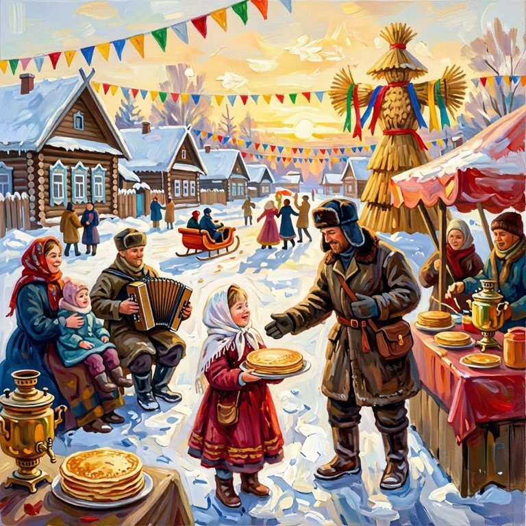

# Что мы добавили и почему это круто

Исходная версия умела одно: два художника уточняли детали у эксперта, рисовали, эксперт
оценивал картину по её текстовому описанию. Ниже — что появилось сверх этого. Для каждого
пункта: что сделано, почему это важно и как мы убедились, что работает.

## Главное в трёх строках

- **Эксперт стал честным**: оценивает саму картину, а не пересказ слабой модели, и не
  штрафует за то, чего художник сделать не мог (обрезанный промпт, недоступный формат).
- **Появились метрики, не зависящие от вкуса эксперта**: «угадай заказ», стратегии
  перевода, дрейф смысла в «испорченном телефоне».
- **Проект стал исследованием культурной асимметрии**: один генератор с русским и
  английским промптом, поговорки, «Нейро-Крокодил» — и наглядный материал (таймлапсы,
  ленты), который можно показывать без слов.

---

## 1. Эксперт смотрит на картину

**Было.** Эксперт не видел картину — только её описание от локальной VLM на 8 млрд
параметров. Такие модели путают «лево» и «право» и ошибаются в счёте объектов, а эксперт
принимал их ошибки за ошибки художника.

**Стало.** Оценку ставит мультимодальная `qwen3.6-35b-a3b` в Yandex AI Studio по самому
изображению. Старый режим остался (`--no-expert-sees-image`) — их можно сравнить.

**Неочевидная находка.** Сначала мы давали эксперту и картину, и описание. Проверили на
картинке, где собака смотрит вправо, с заведомо ложным описанием «смотрит влево»: эксперт
**поверил тексту, а не изображению**. Без описания он ни разу из трёх не ошибся. Вывод,
полезный далеко за пределами проекта: мультимодальная модель при конфликте текста и
картинки склонна верить тексту.

## 2. Промпт помещается в генератор

**Было.** SDXL читает только 77 токенов CLIP, Yandex ART — 500 символов. Всё, что дальше,
молча отбрасывалось: эксперт штрафовал за детали из конца промпта, которых модель не видела
(в одном прогоне CLIP отрезал «clouds, slanting rain, waves bursting on rocks»).

**Стало.** Генератор сам сообщает художнику своё ограничение и проверяет промпт. Не
уложился — художник сокращает сам. LLM не умеет считать токены, поэтому лимит переводится в
слова по фактическому соотношению («сейчас 59 слов — сократи до 46»). Если и это не помогло,
промпт обрезается по границе фразы с конца, где второстепенное.

**Проверка.** Промпт 88 токенов → 66–70; Yandex ART 596 символов → 424–470. При искусственном
лимите в 50 токенов: без подсказки в словах LLM металась 62 → 55 → 61, с подсказкой —
одна попытка, 46 токенов.

## 3. Художник пишет то, что генератор поймёт

- **Без отрицаний.** Генераторы не понимают «без ошейника» и часто рисуют как раз ошейник.
  Было 3 промпта с отрицаниями из 6, стало 0 из 6.
- **Без слов, на которые реагирует модерация.** Yandex ART отказался рисовать лису из-за
  «лиса без одежды». После правки — нарисовал.
- **Без формата кадра и надписей.** Оба генератора рисуют квадрат, а эксперт договаривался о
  16:9 и снижал оценку за то, что физически невыполнимо. Теперь формат знают все участники.

## 4. Надёжность

- **Обязательные поля в ответах LLM.** Художник однажды вернул JSON с пустым промптом —
  картина по пустой строке получила 1/10 (слепой зритель назвал её «Весенняя дорога»).
  Теперь такой ответ повторяется.
- **Поле `prompt` раньше `reasoning`.** С длинным рассуждением впереди модель в 1 случае из 6
  закрывала JSON, так и не написав промпт. После перестановки — 10 из 10.
- **Повторы при сетевых сбоях** с нарастающей паузой; отказы модерации не повторяются.
- **Упавший прогон не обрывает серию.**

## 5. Воспроизводимость и честный эксперимент

- **Seed SDXL**: тот же промпт — та же картина до пикселя. Разница между итерациями зависит
  только от промпта.
- **Seed Yandex ART через API не фиксируется** — проверили: одинаковый seed, разные картины.
  Поэтому выводы делаются только по сериям повторов, а не по одному прогону.
- **Серии** `agent-artist-experiment run`: одна идея в обоих режимах, порядок режимов
  чередуется, длина прогонов фиксирована, в сводке — среднее ± стандартное отклонение.

## 6. Культурная асимметрия: художник C

Раньше A и B различались сразу генератором и языком промпта — эффект языка нельзя было
отделить от силы генератора. Художник **C — Yandex ART с английским промптом**:

- **B против C** — один генератор, разные языки: чистый эффект языка;
- **A против C** — один язык, разные генераторы.

На этом построены две серии: культурные идеи (Масленица, Баба-Яга, двор хрущёвки, «Мороз и
солнце») против нейтральных и поговорки.

## 7. «Угадай заказ» — метрика без вкуса эксперта

Слепой зритель видит **только картину** — ни идеи, ни промпта — и называет её тему.
Судья сравнивает это с настоящим заказом: узнана ли идея (по смыслу и почти дословно) и
какая доля согласованных пунктов передана.

**Почему это круто.** Оценка эксперта субъективна и знает, что художник *пытался*
нарисовать. Слепой зритель знает только то, что на картине *есть*. Это прямое измерение
того, сколько информации из диалога дошло до изображения — ровно то, что изучает проект.

**Проверка.** Картина с лисой против заказа «Маяк в шторм» — не узнано, 0 из 4 пунктов.
Картина, сгенерированная по пустому промпту, — «Весенняя дорога», 0%.

## 8. «Нейро-Крокодил»: поговорки только изображением

Идея — поговорка («Делить шкуру неубитого медведя», «Вешать лапшу на уши», «Рукописи не
горят»), надписи запрещены, слепой зритель угадывает. Англоязычный художник вынужден
переводить, и отдельный анализ размечает, **как**: дословными образами (медведь и шкура),
образами английского аналога (цыплята — «don't count your chickens») или своими образами
для смысла. Проверка разметки на четырёх промптах — 4 из 4.

## 9. «Испорченный телефон»

Художник рисует по идее, слепой зритель описывает картину, следующий художник рисует
**только по описанию** — и так по цепочке. Судья на каждом шаге оценивает сходство с исходной
идеей. Это асимметрия контекста в чистом виде: каждый знает только то, что ему пересказали.

Первая же проверка: «Делить шкуру неубитого медведя» → охотник ужинает с медведем («Лесной
ужин», 2/10) → «Bear Picnic» → «Медвежий осенний пикник» (1/10). Смысл поговорки умер на
первом пересказе — дальше картинка уехала в детскую книжку.

## 10. Таймлапс эволюции и ленты

Для каждого прогона автоматически: `timelapse.webp` (сайт) и `timelapse.gif` (слайды) —
художники рядом, итерации с плавными переходами, оценка и главное замечание эксперта, при
отказе генератора — отклонённый промпт; `evolution.png` — сетка «художники × итерации».
Для «телефона» — лента `telephone.png`. Это материал, который объясняет эксперимент без слов.

## 11. Карта непосильных деталей

`agent-artist-experiment limits` размечает каждое замечание эксперта по категориям — поза и
анатомия, лево/право и композиция, количество объектов, лишние и недостающие объекты, свет,
цвет, стиль, история, текст — и считает долю каждой категории по генераторам. Это прямой
ответ на заявленную в отчёте цель «изучить ограничения моделей генерации» — на сотнях
замечаний, которые уже накопились в логах. Проверка классификатора на 8 размеченных вручную
замечаниях — 8 из 8.

## 12. Модерация: разбор и переписывание

Yandex ART отказывался рисовать Масленицу. Сначала казалось, что дело в сжигании чучела, но
пошаговая проверка показала другое: модерацию вызывает **церковь** — «церковь в дымке» и
«church in the haze» отклоняются 2 из 2 на обоих языках, а та же сцена без церкви проходит.
Фильтр срабатывает на слова, а не на смысл сцены: мирная ярмарка с церковью на горизонте
для него недопустима.

Флаг `--rephrase N`: после отказа художник переписывает промпт, сохраняя смысл и убирая
рискованное. Промпт, который отклонялся каждый раз, после одного переписывания нарисован:
«горит чучело» стало «соломенной фигурой с лентами», церковь исчезла, Масленица узнаётся.

## 13. Разные заказчики и галерея

Пять экспертов с разными вкусами (`--expert`): кинематографист, минималист, любитель барокко,
шестилетний ребёнок, ворчливый передвижник. Одна идея у разных заказчиков показывает, что вкус
действительно передаётся через диалог. `agent-artist-experiment gallery` собирает лучшие
картины нескольких прогонов в одну сетку «художники × заказчики / идеи / режимы».

## 14. Слепой тест с людьми

Страница [«Две картины, одна идея»](https://claude.ai/artifact/NL9Jn4yeAKQCnpa6X5yAHK): человек
видит идею и две картины Yandex ART в случайном порядке — от русского и от английского
промпта — и выбирает, какая точнее передаёт идею. Какая есть какая, раскрывается только после
голосования, вместе с общими итогами. 20 пар: культурные идеи (Масленица, Баба-Яга, «Мороз и
солнце») и нейтральный «Маяк в шторм» для контроля — на нём у людей предпочтения быть не должно.
Голоса хранятся в общей базе страницы, по документу на человека; сравнить их с оценками
LLM-эксперта и слепого зрителя можно через `ArtifactData`. Страница приватная: голосовать могут
те, кому владелец дал доступ участника (Contributor).

## 15. Проверки самого цикла критики

Когда выяснилось, что итерации в среднем не улучшают картину, мы проверили объяснения по очереди:

- **«Опытный художник»** (`--experienced`): генератор сообщает художнику свои типичные промахи из
  карты непосильных деталей. Помогает слабому SDXL, у Yandex ART снижает долю замечаний про свет.
- **«Не забывать лучшее»** (`--keep-best`): художник правит лучшую попытку, а не последнюю.
  Гипотеза «художник забывает» не подтвердилась — честный отрицательный результат.
- **«Движущаяся мишень»** (`agent-artist-experiment drift`): первую и последнюю картину эксперт
  оценивает заново с одним, финальным контекстом — так прогресс художника отделяется от
  ужесточения требований. Оба эффекта оказались малы.
- **«Шумовой пол»** (`agent-artist-experiment noise`): разброс оценки той же картины и того же
  промпта. Это линейка для всех выводов: одна оценка гуляет примерно на ±0.9 балла.

- **Тест управляемости** (`agent-artist-experiment control`, с `--complexity` — кривая сложности):
  промпты с проверяемыми фактами без художника-LLM. SDXL выполняет 33–62% указаний, Yandex ART —
  91–100%, даже шесть сразу.

Так один неожиданный результат превратился в цепочку проверяемых гипотез. Итог: у SDXL узкое
место — управляемость, а у Yandex ART — вкусовые требования эксперта и шум судьи. Две гипотезы
по дороге не подтвердились, и это тоже записано.

## 16. Значения по умолчанию после экспериментов

Пока шли серии, новые правила держались за флагами, чтобы не менять условия посреди
эксперимента. После серий включено по умолчанию: художник переписывает промпт после отказа
модерации (до двух раз) и пишет «манишка», а не «грудь». Проверка: лиса у художника с русским
промптом, на которой раньше было 10 отказов из 12, нарисована 2 из 2 с первой попытки.

## 17. Инженерия

- Пакет `src/agent_artist/` по модулю на роль вместо одного файла на 800 строк;
  настройки — объект `Settings` вместо глобальных констант.
- Команды `agent-artist` и `agent-artist-experiment`, параметры командной строки.
- Генерация на GPU Apple (MPS): картинка за ~7 с вместо минут на CPU.
- Кеши `recovery.json`, `translation.json`, `limits.json`: повторный анализ ничего не стоит.
- `--no-describe`: эксперту, который видит картину, локальное описание не нужно — без него
  прогон быстрее на ~40 с на картину и не занимает общую очередь Ollama.
- Ноутбук `Agent_Artist.ipynb` читает только готовые данные: перезапуск бесплатный.
