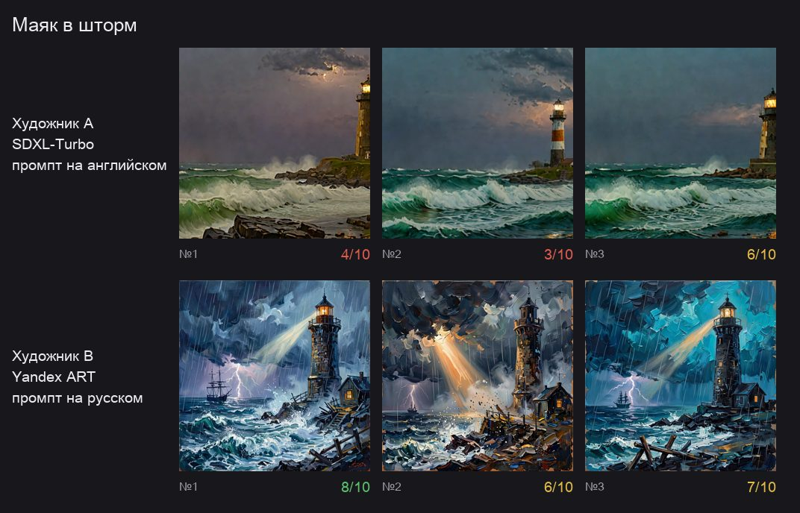
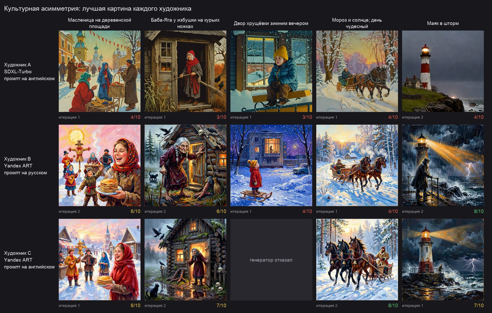
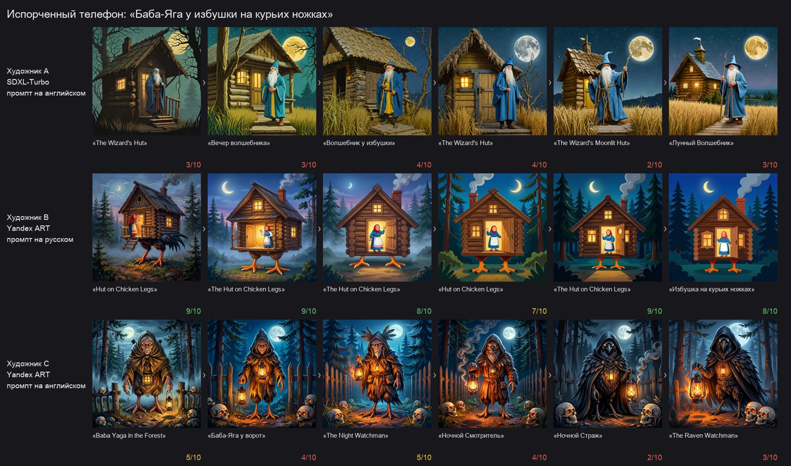
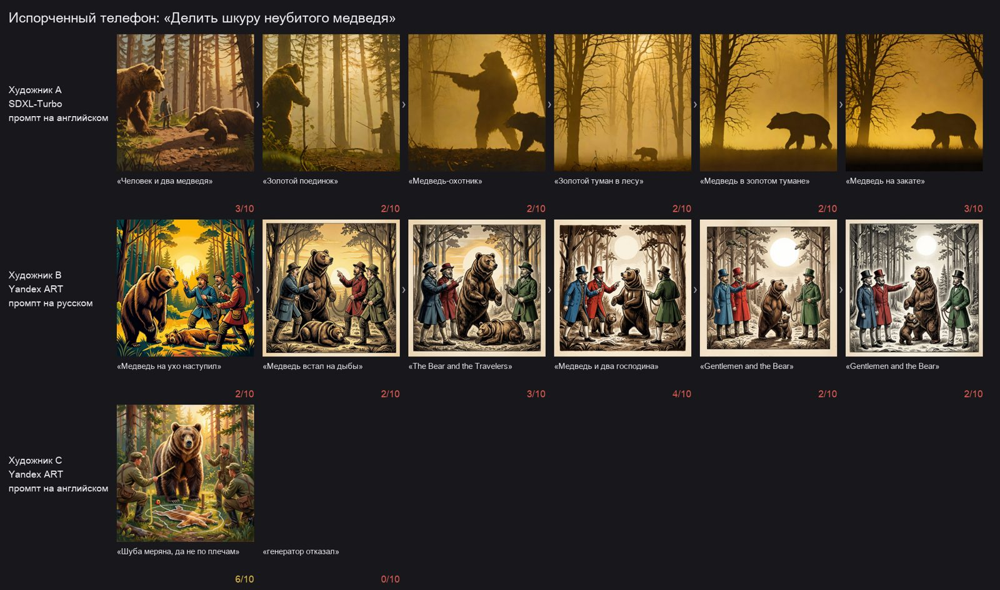
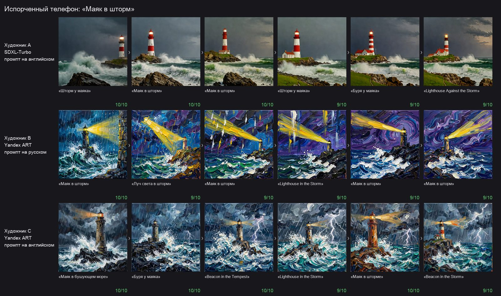
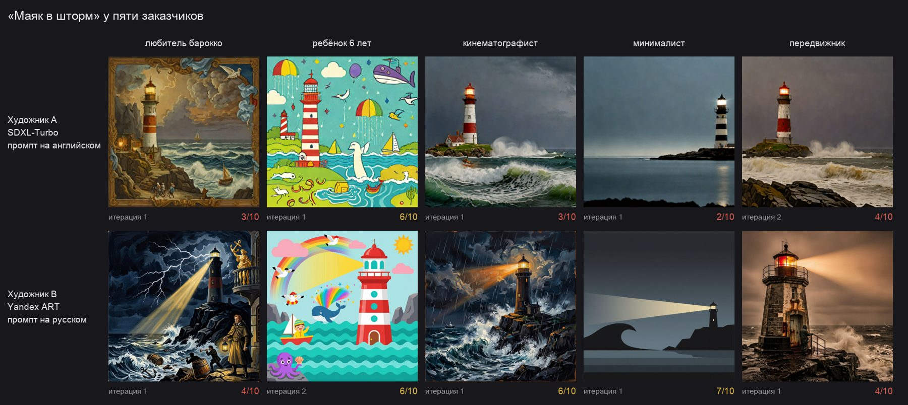

# Результаты экспериментов

Все числа получены командами `agent-artist-experiment summary / recover / translation / limits`
по прогонам в `runs/`; разбор с графиками — в [`Agent_Artist.ipynb`](../Agent_Artist.ipynb).
Как устроены метрики и почему им можно доверять — в [`features.md`](features.md).

**Художники:** A — SDXL-Turbo, промпт на английском; B — Yandex ART, на русском;
C — Yandex ART, на английском. **Эксперт** оценивает саму картину (`qwen3.6-35b-a3b`).

> Важно про масштаб. LLM и Yandex ART недетерминированы, а повторов в каждой ячейке —
> 2–6. Поэтому ниже различаются **выводы** (эффект большой и повторяется в разных метриках)
> и **тенденции** (эффект виден, но в пределах разброса).

---

## 1. Общий контекст: помогает ли видеть вопросы других художников

Идея «Маяк в шторм», художники A и B, три итерации без ранней остановки, по 2 полных прогона
на режим (ещё 2 прогона упали из-за сбоев сети и ответа LLM без промпта — после этого оба
сбоя исправлены).

**Оценка эксперта:**

| Художник | Режим | Первая | Последняя | Лучшая |
|---|---|---|---|---|
| A (SDXL) | isolated | 4.5 ± 2.1 | 4.0 ± 0.0 | 5.0 ± 1.4 |
| A (SDXL) | shared | 4.0 ± 0.0 | 5.5 ± 0.7 | 5.5 ± 0.7 |
| B (Yandex ART) | isolated | 6.5 ± 0.7 | 6.0 ± 2.8 | 7.5 ± 0.7 |
| B (Yandex ART) | shared | 7.0 ± 1.4 | 7.0 ± 0.0 | 8.0 ± 0.0 |

**«Угадай заказ»** — какая доля согласованных пунктов видна на картине слепому зрителю
(по 6 картин на ячейку):

| Режим | A (SDXL) | B (Yandex ART) |
|---|---|---|
| isolated | 32% | 59% |
| shared | 47% | 68% |

**Тенденция:** с общим контекстом обе метрики выше у обоих художников — и субъективная оценка
эксперта, и независимая доля переданных деталей (+15 и +9 п. п.). Но повторов мало, а разброс
оценок до ±2.8, так что это гипотеза для серии побольше, а не доказанный эффект. Оговорка: в
режиме shared бриф шире (включает пункты, согласованные другим художником), так что проценты
считаются от разного числа пунктов.

**Вывод про генераторы:** Yandex ART стабильно лучше SDXL-Turbo — на 2–3 балла у эксперта и
почти вдвое по доле переданных деталей. SDXL-Turbo за 4 шага на 512×512 и 77 токенах промпта
просто не вмещает подробный заказ.

---

## 2. Культурная асимметрия

Четыре культурные идеи (Масленица, Баба-Яга, двор хрущёвки, «Мороз и солнце; день чудесный»)
и две нейтральные для контроля (маяк, лиса); художники A, B, C с **полным диалогом** с экспертом,
по 2 прогона × 2 итерации на идею. Сравнение B и C — один генератор, разные языки промпта.

**Слепой зритель** — узнал ли идею по картине (в скобках — назвал почти дословно):

| Идея | A (SDXL, англ.) | B (Yandex ART, рус.) | C (Yandex ART, англ.) |
|---|---|---|---|
| Масленица на деревенской площади | **0%** | 100% (50%) | 100% (100%) |
| Баба-Яга у избушки на курьих ножках | **25%** | 100% (33%) | 100% (0%) |
| Двор хрущёвки зимним вечером | **25%** | 100% (**100%**) | 100% (**0%**) |
| Мороз и солнце; день чудесный | 0% | 0% | 0% |
| Маяк в шторм *(нейтральная)* | 100% | 100% | 100% |
| Лиса в зимнем лесу *(нейтральная)* | 100% | 100% | 100% |

**Вывод 1 — генератор важнее языка.** SDXL-Turbo не передаёт русские культурные реалии даже
при подробном заказе и транслитерированном промпте: Масленица у него — ярмарка в европейском
городке, у Бабы-Яги нет курьих ножек, вместо хрущёвки — ребёнок у окна. Нейтральные идеи он
передаёт всегда. Yandex ART передаёт культурные идеи на обоих языках.

**Вывод 2 — при полном диалоге язык почти не важен: культура переезжает в промпт через детали.**
Английские промпты **транслитерируют** реалии («Baba Yaga» в 7 промптах из 8, «Maslenitsa» в 5
из 8) и переносят конкретные детали из диалога («chicken legs», «pancakes»). Оценки эксперта у
B и C близки (разрыв B − C на культурных идеях −1.5, на нейтральных +0.65 — в пределах разброса
при 2–4 картинах на ячейку). Единственный намёк на эффект языка — точность названия: хрущёвку
на картинах B зритель называет дословно всегда, на картинах C — ни разу.

**Вывод 3 — цитату нарисовать нельзя.** «Мороз и солнце; день чудесный» не узнал никто: картина
зимнего солнечного дня передаёт сюжет строки, но не то, что это Пушкин.

**Вместе с «Испорченным телефоном»** (раздел 4) получается одна история: **культура живёт в
контексте.** Пока у художника есть подробный диалог, английский промпт не теряет культурный
образ. Когда остаётся только короткий пересказ, английская цепочка уплывает в западные архетипы
(Баба-Яга → «Raven Watchman»), а русская держится. Асимметрия контекста и асимметрия языка
усиливают друг друга.

**Модерация** отклонила 25–50% картин Yandex ART на культурных идеях — и даже на нейтральной
«Лисе» (у B 50%). На Масленице причина найдена: церковь (см. [features.md](features.md#12-модерация-разбор-и-переписывание)).

---

## 3. «Нейро-Крокодил»: поговорки

*Раздел дописывается по завершении серии `experiments/proverbs.sh`.*

---

## 4. «Испорченный телефон»

Шаг 0 — картина по идее; дальше слепой зритель описывает картину, и следующий художник рисует
**только по описанию**. Судья оценивает сходство с исходной идеей (0–10). Шесть шагов, три идеи.

| Идея | A (SDXL, англ.) | B (Yandex ART, рус.) | C (Yandex ART, англ.) |
|---|---|---|---|
| Маяк в шторм | 10 → 9 (ср. 9.5) | 10 → 9 (ср. 9.2) | 10 → 9 (ср. 9.7) |
| Баба-Яга у избушки на курьих ножках | 3 → 3 (ср. 3.2) | **9 → 8 (ср. 8.3)** | 5 → 3 (ср. 3.8) |
| Делить шкуру неубитого медведя | 3 → 3 (ср. 2.3) | 2 → 2 (ср. 2.5) | 6, затем отказ модерации |

**Вывод 1 — нейтральная идея переживает пересказы, культурная и поговорка — нет.** «Маяк в
шторм» держится на 9–10 все шесть шагов у всех художников: дрейфуют только детали и стиль
(у A сцена обрастает домом и травой, у B мазок закручивается, небо становится фиолетовым).

**Вывод 2 — культурный образ сохраняется только на русском промпте.** Баба-Яга:

- **A (SDXL)** не знает Бабу-Ягу и с первого кадра подменяет её **западным волшебником** в
  синей мантии — «The Wizard's Hut» → «Лунный волшебник»;
- **B (Yandex ART, рус.)** держит «Избушку на курьих ножках» с бабушкой в платке все шесть шагов;
- **C (тот же Yandex ART, англ.)** узнаёт Бабу-Ягу только на шаге 0, дальше образ уплывает в
  западное тёмное фэнтези: «Night Watchman» → «Raven Watchman» — существо в капюшоне с черепами.

Генератор у B и C один и тот же — значит, культурный образ теряется именно на английском языке.

**Вывод 3 — поговорка умирает на первом же пересказе.** Художники рисуют буквальные образы
(охотники и медведь), и зритель уже не видит в них поговорку: у B он прочитал картину как
**другую** поговорку — «Медведь на ухо наступил», дальше сюжет ушёл в гравюру в духе басен
Крылова («Gentlemen and the Bear»). C нарисовал поговорку почти дословно — охотники обводят мелом
шкуру на земле, а живой медведь стоит рядом, — зритель угадал смысл («Шуба мерена, да не по
плечам», 6/10), но следующий промпт отклонила модерация, и цепочка оборвалась.

---

## 5. Карта непосильных деталей

Каждое замечание эксперта к нарисованной картине отнесено к одной категории (классификатор
проверен на 8 размеченных вручную замечаниях — 8 из 8). 481 замечание к картинам всех
завершённых прогонов; доли — от всех замечаний к генератору.

| Категория замечаний | SDXL-Turbo (n=253) | Yandex ART (n=228) |
|---|---|---|
| нет заказанных объектов, персонажей или деталей | **21%** | 14% |
| расположение и направление: лево/право, взгляд, композиция, ракурс | 14% | **19%** |
| свет, тени, время суток, погода | 13% | **18%** |
| цвет, палитра | 12% | 11% |
| стиль и техника | 10% | 12% |
| поза, жест, анатомия | 9% | 10% |
| лишние объекты | 9% | 8% |
| настроение, история, напряжение момента | 2% | 4% |
| неверное количество объектов | 1% | 1% |
| надписи и текст | 1% | 0% |

**Вывод:** у генераторов разные слабые места. SDXL-Turbo чаще всего **теряет заказанное**:
77 токенов промпта и 4 шага генерации не вмещают подробный заказ. Yandex ART рисует почти всё,
что заказано, но хуже всего справляется с **расположением** (кто где стоит, куда смотрит,
в какой трети кадра) и **светом**: он знает, *что* нарисовать, но плохо выполняет указания,
*где* и *как*. Счёт объектов и текст почти не встречаются в замечаниях — эти классические
слабости генераторов в наших заказах просто не проверялись.

---

## 6. Опытный художник

Художник знает типичные промахи своего генератора из карты непосильных деталей (`--experienced`):
SDXL-Turbo — оставить 3–4 главных объекта, Yandex ART — явно задать расположение, взгляд и свет.
Идеи «Маяк в шторм» и «Лиса в зимнем лесу», художники A и B, по 2 прогона × 2 итерации.

| | обычный | опытный |
|---|---|---|
| A (SDXL), доля пунктов заказа, видных зрителю — маяк | 38% | **50%** |
| A (SDXL), то же — лиса | 44% | 48% |
| A (SDXL), первая оценка эксперта — лиса | 4.5 | **7.5** |
| B (Yandex ART), доля пунктов заказа — маяк | 55% | 57% |
| B (Yandex ART), лучшая оценка — маяк | 7.0 | 6.0 |
| Yandex ART: доля замечаний про свет | 31% | **22%** |
| Yandex ART: доля замечаний про расположение | 15% | 22% |

**Тенденция:** советы помогают слабому генератору — у SDXL на картинах видно больше заказанного
(+4…+12 п. п.), первая оценка на лисе выросла с 4.5 до 7.5. У Yandex ART советы сработали
точечно: замечаний про свет стало заметно меньше — ровно туда и был совет, — но доля
замечаний про расположение выросла, а оценки не изменились. Повторов мало, поэтому это
направление для серии побольше, а не вывод. Все картины B на лисе отклонила модерация — см. ниже.

---

## 7. Разные заказчики

Одна идея — «Маяк в шторм» — у пяти экспертов с разными вкусами, художники A и B, две итерации.

**Вывод:** вкус заказчика полностью доходит до картины через диалог. Любитель барокко получил
золочёную раму и аллегорию Надежды с якорем, шестилетний ребёнок — радугу, кита и осьминога,
минималист — плоскую графику в три цвета с одним лучом, передвижник — сепию, ржавый маяк и
смотрителя с фонарём. Стиль меняется даже у слабой SDXL-Turbo: эксперт задаёт его в ответах на
вопросы, художник переносит в промпт. Оценки при этом невысокие (2–7) — эксперт с сильным вкусом
придирчив к деталям, — но узнаваемость вкуса абсолютная.

---

## 8. Помогает ли цикл критики

По всем прогонам с двумя и более итерациями (74 пары «художник × прогон», отказы генератора
исключены):

| Художник | Первая оценка | Последняя | Последняя − первая | Лучшая − первая |
|---|---|---|---|---|
| A (SDXL) | 3.75 | 3.67 | −0.08 | +0.47 |
| B (Yandex ART, рус.) | 5.38 | 5.58 | +0.19 | +0.81 |
| C (Yandex ART, англ.) | 5.67 | 5.92 | +0.25 | +1.08 |

Последняя картина лучше первой в 38% прогонов, хуже — в 35%, такая же — в 27%.

**Вывод:** в среднем итерации картину **не улучшают** — они ведут себя как пересэмплирование, а не
как обучение. Лучшая картина прогона выше первой примерно на столько, сколько даёт случайный
выбор лучшего из двух-трёх попыток при разбросе оценок около ±1.4. Вероятная причина: на каждую
критику эксперт отвечает новыми требованиями (медиана — 16 согласованных пунктов за прогон),
промпт ограничен, и, исправляя новое, художник теряет старое. Проверка гипотезы — следующий
раздел.

---

## Наблюдения по ходу работы

- **Мультимодальная модель верит тексту больше, чем картинке.** С картинкой и ложным описанием
  («собака смотрит влево») эксперт повторил ошибку описания; без описания — ни разу из трёх.
- **LLM не умеет считать токены, но умеет слова.** Подсказка «сократи до 46 слов» работает с первой
  попытки; «уложись в 77 токенов» — нет (62 → 55 → 61).
- **Отрицания вредят.** «Без ошейника» рисует ошейник; «лиса без одежды» вызвала отказ модерации.
- **Yandex ART не фиксирует seed через API** — одинаковый seed даёт разные картины, поэтому
  выводы делаются только по повторам.
- **Модерация Yandex ART работает по словам, а не по смыслу — и штрафует русский язык.**
  «Церковь в дымке» на ярмарке отклоняется на обоих языках, а «храм вдали» проходит. «Рыжая
  лиса… белая грудь» — отказ 2 из 2, «белая манишка» и английское «white chest» — нарисовано
  2 из 2: русское «грудь» двусмысленно, и фильтр видит в нём наготу. Отсюда 10 отказов из 12
  у художника с русским промптом на нейтральной «Лисе в зимнем лесу».
- **Вкус заказчика влияет на модерацию.** У любителя барокко сцена шторма стала аллегорией
  кораблекрушения с моряком, привязанным к обломку, — её отклонили трижды, даже после двух
  переписываний промпта.
